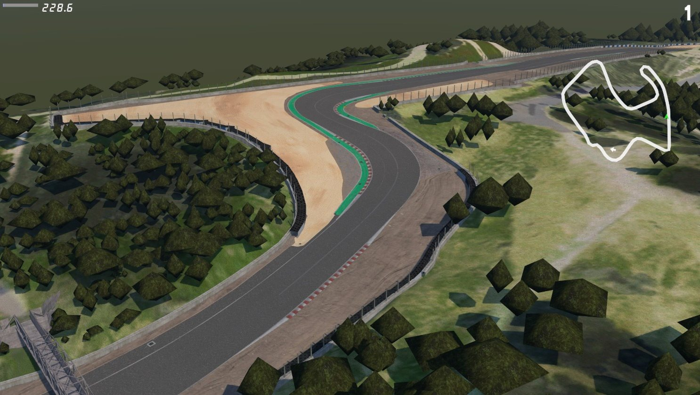
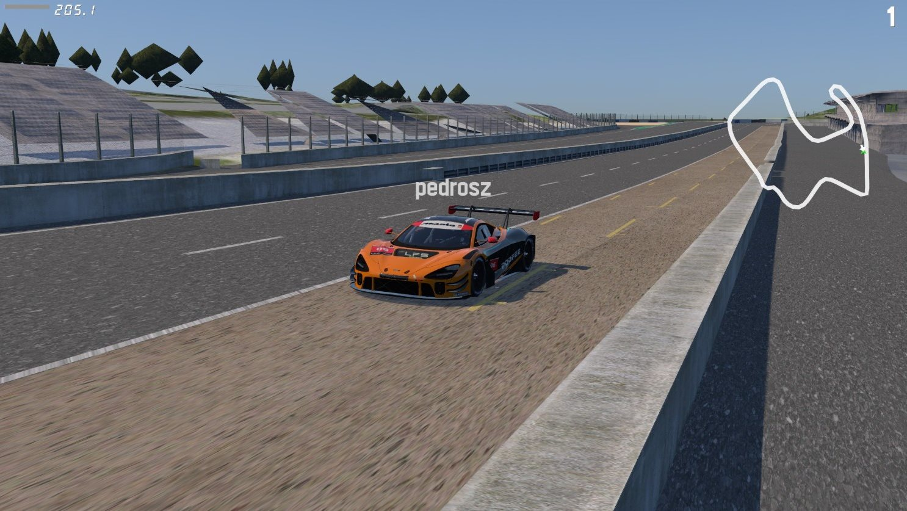
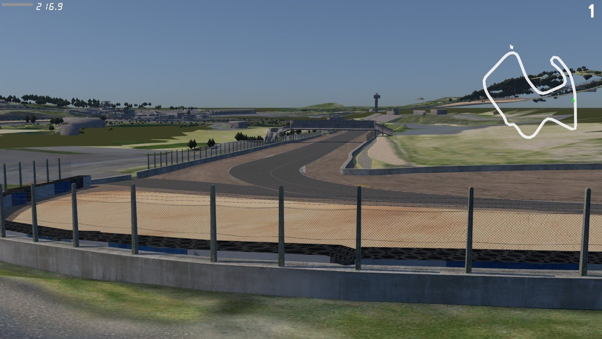
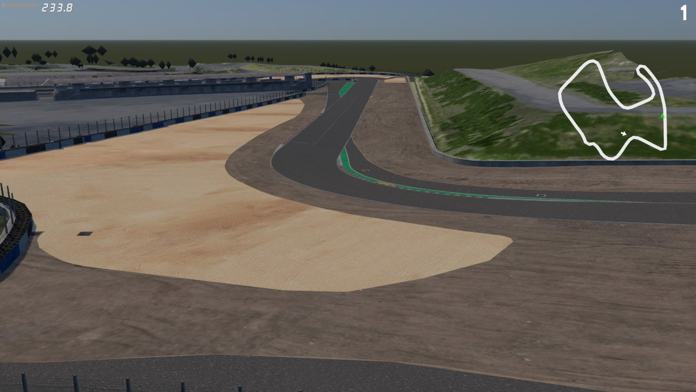

# Laguna Seca for Live for Speed (replaces Blackwood)

| | |
|---|---|
|  |  |
|  | |

## Credits

**Track:** "Laguna Seca 2026" (v0.7) by **Fenryr**, made for Assetto Corsa.
<https://www.patreon.com/fenryr24>
This package is a conversion of Fenryr's work. The track geometry, textures, barrier layout, racing line and pit positions all come from that mod. All credit for the track goes to Fenryr, so please support the original.

**Assetto Corsa** was developed by Kunos Simulazioni. The source track was built for their game. This conversion is not affiliated with or endorsed by Kunos Simulazioni.

**Live for Speed** is by Scawen Roberts, Eric Bailey and Victor van Vlaardingen. The barrier materials, posts, pit box model and cameras are reused from LFS's own Blackwood track. This conversion is not affiliated with or endorsed by the LFS developers.

The real circuit is WeatherTech Raceway Laguna Seca in Monterey, California. Its name is used for identification only.

## Compatibility

This package replaces the Blackwood world file. While it is installed:
- other players on Blackwood servers see stock Blackwood, not this track;
- old Blackwood replays and hotlaps will not play back correctly.

Run `uninstall.bat` to go back to stock Blackwood.

## Install

1. Close LFS.
2. Run `install.bat`. It asks for your LFS folder (the default is `C:\LFS`) and then:
   - backs up `data\wld\BLACKWOOD.wld` as `BLACKWOOD.wld.original` (first time only);
   - renames `data\wld\BLACKWOOD.lgh` to `BLACKWOOD.lgh.original`, because Blackwood's lighting data does not belong to this track;
   - copies the new `BLACKWOOD.wld` and the `LAG_*.dds` textures (about 260 MB).
3. In LFS, select **Blackwood - GP Track**. The menus still say "Blackwood".

To install manually, do the same three steps by hand.

## Notes

- All four Blackwood configs load Laguna Seca.
- AI drivers need a normal config such as GP Track, not an open "X" config.
- The first time you add AI, LFS may say it must generate AI path info. Let it.
- There are no floodlights at night, because there is no lighting file. Headlights still work.
- Tested with LFS 0.8C.

## Uninstall

Close LFS and run `uninstall.bat`.
